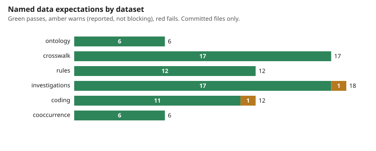
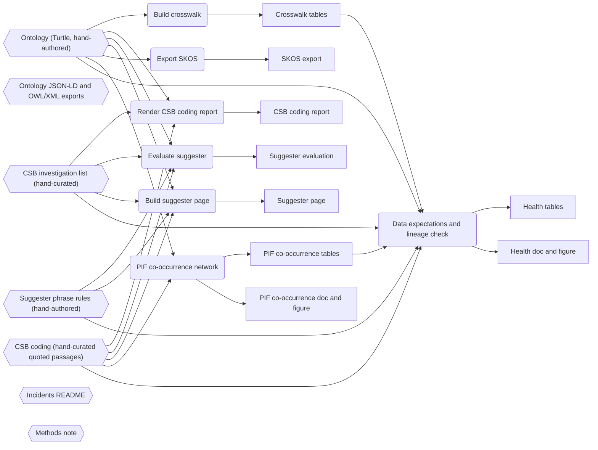

# Data health and pipeline lineage

Generated by `python3 tools/health.py --write`; do not edit by hand. `tests/test_health.py` fails if this file, `docs/health.svg` or `health/*.csv` differ from the generator output.

A Foundry-style practice in plain Python on public data: every rule below is a named expectation over a committed file with an observed value, a limit and a status, and the build pipeline is declared as stages with inputs and outputs and checked against the repository. Independent of and not affiliated with Palantir.

## Result

71 expectations: 69 pass, 2 warn, 0 fail. Rows: `health/health_checks.csv`. Empty-value profile of every column: `health/health_columns.csv`.



| Dataset | Expectations | Pass | Warn | Fail |
|---|---|---|---|---|
| ontology | 6 | 6 | 0 | 0 |
| crosswalk | 17 | 17 | 0 | 0 |
| rules | 12 | 12 | 0 | 0 |
| investigations | 18 | 17 | 1 | 0 |
| coding | 12 | 11 | 1 | 0 |
| cooccurrence | 6 | 6 | 0 | 0 |

## What the warnings say

- H30 `investigations`: investigations with no fatality count recorded (left empty, not zero). Observed 9, limit 0.
- H41 `coding`: factors never coded in any investigation (the incident set cannot test them). Observed 10, limit 0.

Warnings describe the data as it is: they are reported so a reader knows the limit, and they do not block CI. A new error-severity failure does.

## What this does and does not show

- The expectations check consistency between the committed files (ontology, crosswalk, rules, coding, tables) and value domains. They do not check that a quoted CSB passage says what the coding claims, or that an alignment is right: that is `docs/PROVENANCE.md` and the second-coder protocol.
- Null ceilings are judgement, set a little above the committed value so a regression shows.
- The lineage is declared, then validated (paths, functions via ast, undeclared outputs, double producers, cycles); it is not discovered by tracing execution.

## Pipeline lineage

7 stages, 16 artifacts. Hexagons are hand-curated sources, rectangles are committed files.



| # | Stage | Command | Reads | Writes |
|---|---|---|---|---|
| 1 | Build crosswalk | `python3 tools/build_crosswalk.py` | Ontology (Turtle, hand-authored) | Crosswalk tables |
| 2 | Render CSB coding report | `python3 tools/build_csb_coding.py` | Ontology (Turtle, hand-authored), CSB investigation list (hand-curated), CSB coding (hand-curated quoted passages) | CSB coding report |
| 3 | Evaluate suggester | `python3 tools/evaluate_suggester.py` | Ontology (Turtle, hand-authored), Suggester phrase rules (hand-authored), CSB investigation list (hand-curated), CSB coding (hand-curated quoted passages) | Suggester evaluation |
| 4 | Build suggester page | `python3 tools/build_suggester_page.py` | Ontology (Turtle, hand-authored), Suggester phrase rules (hand-authored), CSB investigation list (hand-curated), CSB coding (hand-curated quoted passages) | Suggester page |
| 5 | Export SKOS | `python3 tools/build_skos.py` | Ontology (Turtle, hand-authored) | SKOS export |
| 6 | PIF co-occurrence network | `make pif-cooccurrence` | Ontology (Turtle, hand-authored), CSB coding (hand-curated quoted passages) | PIF co-occurrence tables, PIF co-occurrence doc and figure |
| 7 | Data expectations and lineage check | `make health` | Ontology (Turtle, hand-authored), Crosswalk tables, Suggester phrase rules (hand-authored), CSB investigation list (hand-curated), CSB coding (hand-curated quoted passages), PIF co-occurrence tables | Health tables, Health doc and figure |

## Reproduce

```
python3 tools/health.py --write   # or: make health
python3 tools/health.py --check
```
