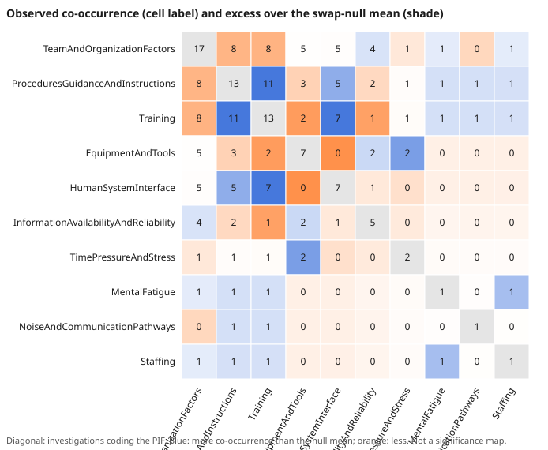

# Do PIFs co-occur beyond what their frequencies imply?

A small network analysis of the performance-influencing factors (PIFs) coded
to U.S. Chemical Safety Board (CSB) investigations in `incidents/csb_coding.csv`.
It asks one question: given how often each PIF is coded and how many PIFs each
investigation carries, which PIF pairs appear together more or less often than
chance would give?

Reproduce: `python3 tools/pif_cooccurrence.py --write` (stdlib only, seeded,
about 3 seconds). `make pif-cooccurrence` does the same.

## Results

<!-- BEGIN GENERATED BY tools/pif_cooccurrence.py; do not hand-edit -->

- Data: 67 codings over 23 coded investigations; 10 of the 20 ontology PIFs appear at least once (10 PIFs never coded).
- 27 of 45 possible PIF pairs co-occur in at least one investigation.
- Most frequent pair: ProceduresGuidanceAndInstructions + Training in 11 investigations (null mean 7.12, upper-tail p = 0.0007, Holm two-sided p = 0.0675).
- Pairs with upper-tail p <= 0.05 before adjustment: 3 of 45 (about 2.2 expected by chance alone); with Holm adjustment (two-sided): 0.
- Global concentration statistic (sum of squared pair counts): observed 428, upper-tail p = 0.1432.

PIF prevalence and weighted degree (sum of co-occurrences; bootstrap 95% interval):

| PIF | Investigations | Prevalence (Wilson 95%) | Weighted degree (bootstrap 95%) |
|---|---:|---|---|
| TeamAndOrganizationFactors | 17 | 74% (54% to 87%) | 33 (20 to 45) |
| ProceduresGuidanceAndInstructions | 13 | 57% (37% to 74%) | 33 (20 to 47) |
| Training | 13 | 57% (37% to 74%) | 33 (20 to 47) |
| EquipmentAndTools | 7 | 30% (16% to 51%) | 14 (6 to 24) |
| HumanSystemInterface | 7 | 30% (16% to 51%) | 18 (7 to 30) |
| InformationAvailabilityAndReliability | 5 | 22% (10% to 42%) | 10 (2 to 20) |
| TimePressureAndStress | 2 | 9% (2% to 27%) | 5 (0 to 13) |
| MentalFatigue | 1 | 4% (1% to 21%) | 4 (0 to 12) |
| NoiseAndCommunicationPathways | 1 | 4% (1% to 21%) | 2 (0 to 6) |
| Staffing | 1 | 4% (1% to 21%) | 4 (0 to 12) |

Five most frequent pairs:

| Pair | Observed | Null mean | Upper-tail p | Holm two-sided p |
|---|---:|---:|---:|---:|
| ProceduresGuidanceAndInstructions + Training | 11 | 7.12 | 0.0007 | 0.0675 |
| ProceduresGuidanceAndInstructions + TeamAndOrganizationFactors | 8 | 9.36 | 0.9695 | 1.0000 |
| TeamAndOrganizationFactors + Training | 8 | 9.39 | 0.9748 | 1.0000 |
| HumanSystemInterface + Training | 7 | 3.80 | 0.0042 | 0.3739 |
| HumanSystemInterface + ProceduresGuidanceAndInstructions | 5 | 3.78 | 0.2549 | 1.0000 |

<!-- END GENERATED -->

Machine-readable outputs: `incidents/pif_cooccurrence_pairs.csv` (all 45 pairs)
and `incidents/pif_cooccurrence_pifs.csv` (per-PIF prevalence and weighted degree).

## Reading it

- The procedures + training pairing is the only pair that stands out clearly
  from the margin-preserving null before correction, and it does not survive the
  Holm adjustment over 45 pairs. Treat it as a lead, not a finding.
- The three most prevalent PIFs are also the highest-degree nodes. Degree here
  mostly restates prevalence; the pair-level null is what separates real
  association from "both are common".
- Team and organization factors is common (17 of 23) and pairs with procedures
  and training slightly less than the null expects, which is what a very common
  code looks like when most investigations carry it anyway.

## Method

1. Each investigation is the set of PIFs coded to it (one row per
   investigation-PIF pair; repeated codings of the same PIF count once).
2. Observed co-occurrence of a pair is the number of investigations coding both.
3. Null: swap randomisation. Two investigations are chosen at random and a PIF
   one has and the other lacks is exchanged, repeatedly. This keeps every
   investigation's PIF count and every PIF's investigation count fixed. 4,000
   null matrices are taken after a 4,000-swap burn-in, 400 swap attempts apart
   (seed 20261106).
4. Upper- and lower-tail p-values use the (count + 1) / (draws + 1) correction.
   The two-sided value is twice the smaller tail, capped at 1, and Holm-adjusted
   over all 45 pairs.
5. Prevalence intervals are Wilson 95%. Weighted degree is the sum over a PIF's
   investigations of (investigation PIF count minus one); its interval is a
   percentile bootstrap over investigations (2,000 resamples, seed 20261107).

## Limitations

- 23 investigations is a small sample; the pair tests have little power and the
  bootstrap intervals are wide.
- The codings are the repository's own, by a single coder, and are shaped by
  what a CSB report chooses to discuss. Recommendation excerpts (41 of the 67)
  can reflect how the CSB writes recommendations, not what happened. No second
  coder data exists (see `second-coder-protocol.md`).
- Investigations are not a random sample of incidents: they are a convenience
  selection of CSB reports, and ten of the 20 PIFs were never coded, so absence
  of a pair says nothing about the unobserved PIFs.
- Co-occurrence is not causation or interaction. Two PIFs coded together may
  both be consequences of one organizational decision.
- The null fixes row and column totals, so it tests association net of
  prevalence and report length only. It does not account for coder habits or the
  development/held-out split of the investigations.
- Only the PIF labels from this ontology are used; no external dataset is
  involved and no figure here is estimated from outside the repository.
